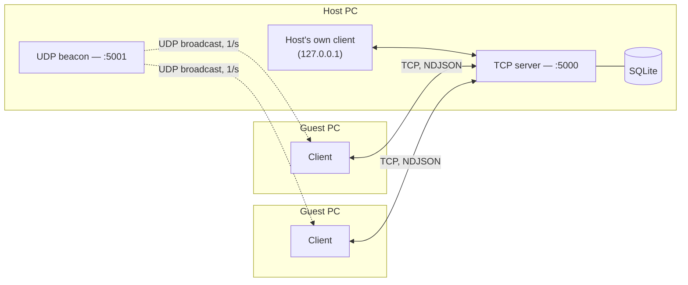

<p align="right"><b>English</b> · <a href="README.ru.md">Русский</a></p>

<h1 align="center">LAN Chat</h1>
<p align="center"><b>A self-contained Windows chat application that needs neither the internet nor a server.</b></p>
<p align="center">
  
  
  
  
  
</p>

Zero-config chat for a local network: one computer hosts, everyone else is found automatically
and joins with one click. No account, no internet connection, no cloud backend, nothing to
install — it's a single `.exe` that's as self-contained as software gets.

<p align="center">
  
</p>

---

## Why this exists

Most chat apps assume you have internet. That assumption breaks down more often than people
expect: classrooms, workshops, offices on an isolated network, field sites, or just a home LAN
where spinning up an account on yet another cloud service feels like overkill for "hey, lunch?".
LAN Chat is built for exactly that gap — point-to-point communication on infrastructure you
already have (a router), with nothing phoning home.

## Screenshots

| Light theme | English UI | About |
|---|---|---|
|  |  |  |

<details>
<summary>Connect screen</summary>

</details>

## Features

**Messaging**
- Group chat plus independent one-on-one conversations with anyone currently online
- Message editing and deletion, with the author's ownership enforced server-side
- Delivery/read receipts (`✓` sent → `✓✓` delivered → `●` read) for private messages
- Live "user is typing…" indicator
- Full chat history persisted in SQLite, replayed to anyone who (re)joins
- Emoji picker, drag-and-drop file sharing (up to 25 MB), clickable file downloads

**Zero-config networking**
- One click to host; everyone else on the subnet discovers the chat automatically over UDP
  broadcast — no IP address to type, ever (manual IP entry is still there as a fallback)
- The host talks to its own server exactly like any other client (same TCP loopback path),
  so there is exactly one code path for the UI to support, not two

**Desktop citizenship**
- System tray integration — closing the window keeps the chat running in the background
- True single-instance behavior: relaunching the `.exe` focuses the existing window instead of
  starting a second process (named mutex + cross-process event, no polling)
- Optional launch-at-startup, toggled through the normal per-user `Run` registry key
- Light/dark theme and three UI languages (RU / EN / TK), both switchable at runtime with no
  restart
- Self-contained single-file publish for both x64 and x86 — copy the `.exe`, run it, done

## Architecture



One host process owns a plain `TcpListener` and a `MessageStore` (SQLite). Every participant —
including the host's own UI — connects to it as an ordinary TCP client and exchanges newline-
delimited JSON packets (`Net/Protocol.cs`). Discovery is a separate, disposable concern: a UDP
beacon the host broadcasts once a second, and a listener any client runs while choosing a chat
to join. Neither path knows about the other, which keeps both simple enough to unit-test in
isolation.

## Engineering notes

A few decisions worth calling out, because they're the kind of thing that's easy to get wrong:

- **Localized text never crosses the network.** System events ("X joined", "X left") and
  notices ("user is offline") are sent as an *event code* + parameters, never as rendered text.
  Each client formats the message in its own language. The alternative — baking Russian text
  into the packet because that's what the sender's UI happens to show — silently breaks the
  moment two participants use different languages.
- **Theming and localization share one mechanism.** Both the color palette and every UI string
  live in `Application.Resources` under `DynamicResource` keys. Switching theme or language is
  the same operation — swap the resource dictionary — so the UI repaints live with no special-
  cased update logic per screen.
- **Message edits, deletes, and read receipts reuse one relay primitive.** All three are
  "this message changed, here's the new version" from the protocol's point of view, so they
  share a single `MessageUpdated` packet type instead of three near-duplicate ones.
- **Files are metadata-first.** Sending a file stores the bytes once, server-side; the broadcast
  to other participants carries only the name and size. The actual bytes are pulled on demand
  when someone clicks to download — nobody pays for a transfer they didn't ask for.
- **The host is just a client.** Rather than branching the UI into "host mode" and "guest mode",
  the host connects to its own TCP server over loopback like anyone else. One UI, one code path,
  provably consistent behavior between roles.
- **Second launch doesn't mean second process.** A named `Mutex` plus a named `EventWaitHandle`
  let a freshly launched instance detect a running one, signal it to come to the foreground, and
  exit immediately — important once "closing" the window means "minimize to tray" rather than
  "quit".

## Tech stack

C# · .NET 10 · WPF · raw `TcpListener`/`TcpClient` sockets (no SignalR/gRPC — a hand-rolled
NDJSON protocol was the right amount of complexity for this problem) · `Microsoft.Data.Sqlite` ·
`System.Windows.Forms.NotifyIcon` for the tray · `System.Threading.Mutex` for single-instance.

## Getting started

```powershell
dotnet run --project src\LanChat        # run from source
.\publish.ps1                           # build dist\LanChat-64bit.exe + dist\LanChat-32bit.exe
```

No further setup — the published `.exe` is fully self-contained (the .NET runtime is bundled
in). On first run on the host machine, allow the app through the Windows Firewall for **private
networks** when prompted. If the prompt gets missed:

```powershell
# run as administrator, on the hosting PC
New-NetFirewallRule -DisplayName "LAN Chat TCP" -Direction Inbound -Protocol TCP -LocalPort 5000 -Action Allow -Profile Private
New-NetFirewallRule -DisplayName "LAN Chat UDP" -Direction Inbound -Protocol UDP -LocalPort 5001 -Action Allow -Profile Private
```

## Project structure

```
src/LanChat/
  Net/        Protocol.cs, ChatServer, ChatClient, UDP discovery (beacon + listener)
  Storage/    MessageStore (SQLite, with inline schema migrations), AppSettings
  Services/   SoundPlayer, TrayIcon, Strings (localization), AutoStart
  Themes/     Dark.xaml / Light.xaml — palette only, hot-swappable
  Models/     ChatMessage, DiscoveredServer, ConversationItem
  MainWindow  Connect screen + chat screen (group + per-peer threads)
```

## Testing

The protocol and persistence layer are covered by a from-scratch integration harness that spins
up a real `ChatServer` and several real `ChatClient`s over actual TCP sockets — not mocks — and
asserts on 60+ scenarios: message ordering, ownership checks on edit/delete, delivery/read
state transitions, offline-recipient handling, SQLite migrations across schema versions, and UDP
discovery end to end (including the "server disappeared" timeout path).

## Deliberate scope limits

- Traffic is unencrypted — this targets trusted local networks, not the public internet.
- One room per host; no federation between hosts.
- Files cap at 25 MB and travel as a single base64 packet — fine for documents and photos, not
  for video.
- Windows 10 (1607+) / 11 only — not a project limitation so much as a .NET 7+ runtime one.

## Author

**Anvar Sharipov** — Programmer / Software Engineer
📧 anvar7235@gmail.com · 💬 [@anvar_sharipov_90](https://t.me/anvar_sharipov_90) · 📱 +993 61 30 43 56

## License

[MIT](LICENSE)
