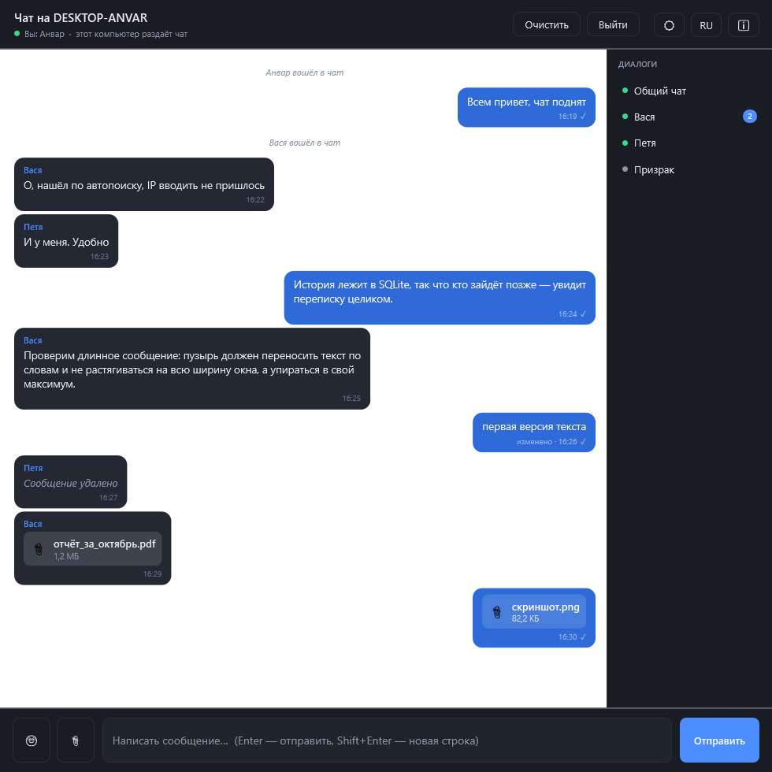
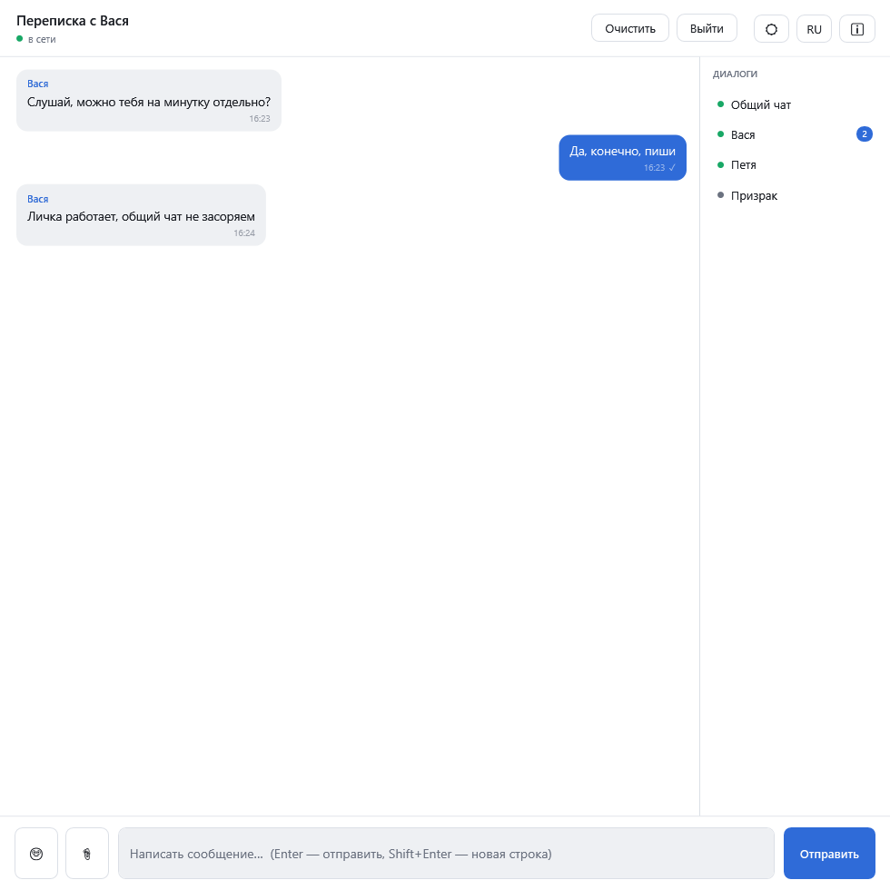
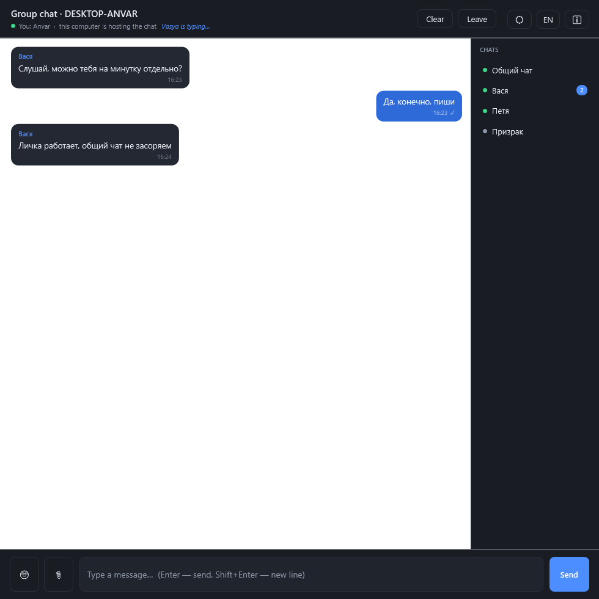
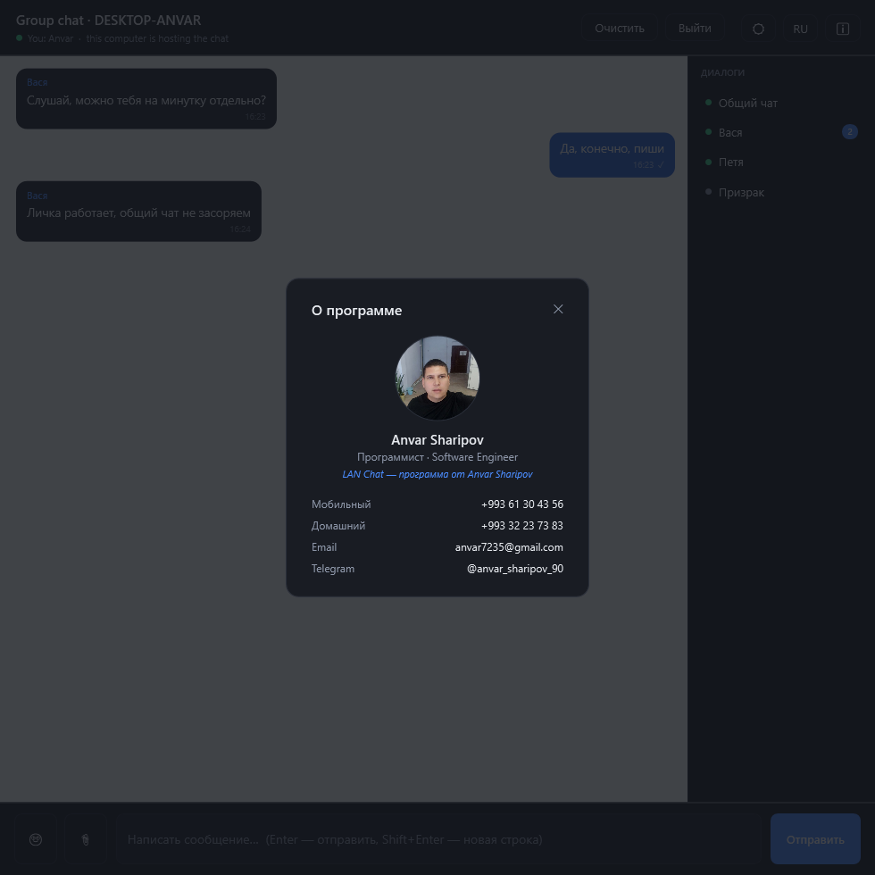
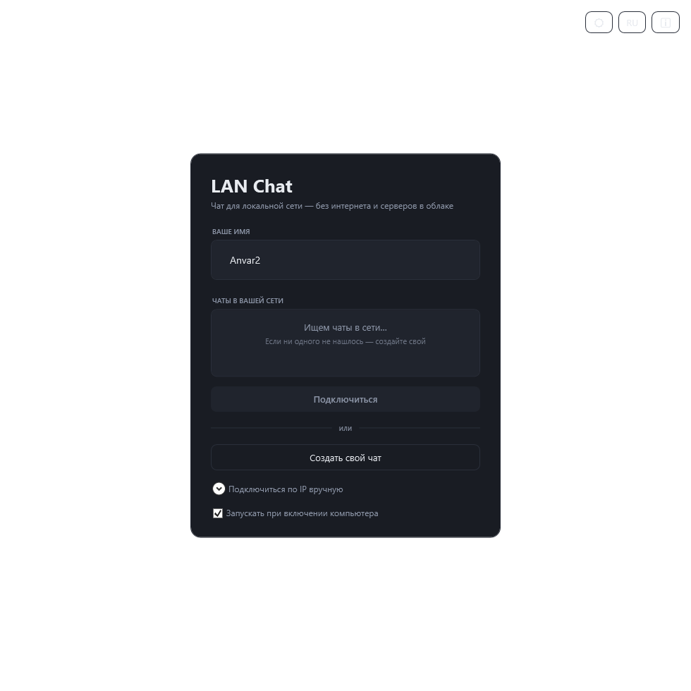
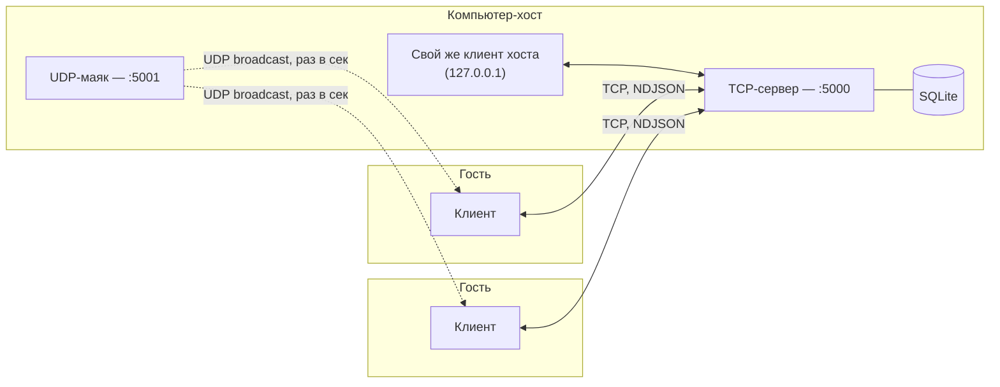

<p align="right"><a href="README.md">English</a> · <b>Русский</b></p>

<h1 align="center">LAN Chat</h1>
<p align="center"><b>Чат для Windows, которому не нужен ни интернет, ни сервер.</b></p>
<p align="center">
  
  
  
  
  
</p>

Чат для локальной сети без единой настройки: один компьютер создаёт чат, остальные находят его
сами и подключаются в один клик. Без аккаунта, без интернета, без облачного бэкенда и без
установки — это один `.exe`, настолько самодостаточный, насколько это вообще возможно.

<p align="center">
  
</p>

---

## Зачем это нужно

Большинство чатов молчаливо предполагают, что у вас есть интернет. Это предположение ломается
чаще, чем кажется: учебные классы, мастерские, офисы в изолированной сети, полевые объекты —
или просто домашняя сеть, где заводить аккаунт в очередном облачном сервисе ради «обед идём?»
избыточно. LAN Chat закрывает именно этот разрыв: связь внутри сети, которая у вас уже есть
(обычный роутер), и ничего, что звонит «домой» в интернет.

## Скриншоты

| Светлая тема | Английский язык | О программе |
|---|---|---|
|  |  |  |

<details>
<summary>Экран подключения</summary>

</details>

## Возможности

**Сообщения**
- Общий чат плюс независимые личные переписки с любым участником, кто сейчас в сети
- Редактирование и удаление сообщений — сервер проверяет авторство, чужое не тронуть
- Статусы доставки для личных сообщений (`✓` отправлено → `✓✓` доставлено → `●` прочитано)
- Индикатор «печатает…» в реальном времени
- Вся история хранится в SQLite и подгружается заново зашедшему участнику
- Эмодзи-пикер, drag-and-drop для файлов (до 25 МБ), скачивание по клику

## Zero-config сеть

- Один клик — и чат создан; все остальные в этой же подсети находят его сами через UDP-
  broadcast — IP вводить не нужно никогда (ручной ввод остался как запасной вариант)
- Хост общается со своим же сервером так же, как любой другой клиент (тот же TCP-путь через
  loopback) — поэтому в интерфейсе ровно один путь кода, а не два разных под хоста и гостя

**Поведение десктоп-приложения**
- Интеграция с системным треем — закрытие окна не завершает программу, чат продолжает работать
- Настоящая защита от повторного запуска: второй `.exe` не плодит второй процесс, а
  разворачивает уже работающее окно (именованный mutex + межпроцессное событие, без опроса)
- Автозапуск с Windows одной галочкой — через обычный пользовательский ключ `Run` в реестре
- Светлая/тёмная тема и три языка интерфейса (RU/EN/TK), переключаются на лету без перезапуска
- Самодостаточная публикация под x64 и x86 — скопировал `.exe`, запустил, всё работает

## Архитектура



Один процесс-хост держит обычный `TcpListener` и `MessageStore` (SQLite). Каждый участник —
включая интерфейс самого хоста — подключается к нему как обычный TCP-клиент и обменивается
JSON-пакетами, разделёнными переводом строки (`Net/Protocol.cs`). Автообнаружение — отдельная,
независимая задача: UDP-маяк, который хост рассылает раз в секунду, и слушатель, который
запускает любой клиент, пока выбирает чат для подключения. Эти два пути ничего не знают друг
о друге — именно поэтому оба достаточно простые, чтобы тестировать изолированно.

## Инженерные решения

Несколько моментов, о которых стоит сказать отдельно — именно такие вещи легко сделать неверно:

- **Переводимый текст никогда не уходит по сети.** Системные события («X вошёл», «X вышел») и
  уведомления («собеседник не в сети») передаются как *код события* + параметры, а не готовым
  текстом. Каждый клиент формирует фразу на своём языке сам. Альтернатива — зашить русский
  текст в пакет, раз уж у отправителя интерфейс на русском — незаметно ломается в тот момент,
  когда у двух участников чата разные языки.
- **Тема и локализация работают по одному и тому же механизму.** И цветовая палитра, и все
  строки интерфейса живут в `Application.Resources` под ключами `DynamicResource`. Смена темы
  или языка — одна и та же операция (подмена словаря ресурсов), поэтому интерфейс перекрашивается
  вживую без отдельной логики обновления для каждого экрана.
- **Правка, удаление и статус прочтения используют один и тот же механизм рассылки.** С точки
  зрения протокола все три случая — это «сообщение изменилось, вот новая версия», поэтому они
  используют один тип пакета `MessageUpdated`, а не три почти одинаковых.
- **Файлы — сначала метаданные.** При отправке файла байты сохраняются один раз на сервере;
  рассылка остальным участникам несёт только имя и размер. Сами байты скачиваются по запросу —
  клик по вложению — так что никто не платит трафиком за передачу, которую не просил.
- **Хост — это просто клиент.** Вместо того чтобы разводить интерфейс на «режим хоста» и «режим
  гостя», хост подключается к своему же TCP-серверу через loopback — так же, как и все
  остальные. Один интерфейс, один путь кода, поведение хоста и гостя доказуемо совпадает.
- **Второй запуск — не значит второй процесс.** Именованный `Mutex` вместе с именованным
  `EventWaitHandle` позволяют только что запущенной копии обнаружить уже работающую, просигналить
  ей развернуться на передний план и сразу завершиться — это важно, раз «закрыть окно» теперь
  означает «свернуть в трей», а не «выйти».

## Стек технологий

C# · .NET 10 · WPF · обычные сокеты `TcpListener`/`TcpClient` (без SignalR/gRPC — свой протокол
на NDJSON был ровно тем уровнем сложности, который нужен для этой задачи) ·
`Microsoft.Data.Sqlite` · `System.Windows.Forms.NotifyIcon` для трея · `System.Threading.Mutex`
для защиты от повторного запуска.

## Быстрый старт

```powershell
dotnet run --project src\LanChat        # запуск из исходников
.\publish.ps1                           # соберёт dist\LanChat-64bit.exe и dist\LanChat-32bit.exe
```

Больше ничего настраивать не нужно — опубликованный `.exe` полностью самодостаточен (рантайм
.NET уже внутри). При первом запуске на компьютере-хосте разрешите доступ в Windows Firewall
для **частных сетей**, когда появится запрос. Если окно пропустили:

```powershell
# от имени администратора, на компьютере-хосте
New-NetFirewallRule -DisplayName "LAN Chat TCP" -Direction Inbound -Protocol TCP -LocalPort 5000 -Action Allow -Profile Private
New-NetFirewallRule -DisplayName "LAN Chat UDP" -Direction Inbound -Protocol UDP -LocalPort 5001 -Action Allow -Profile Private
```

## Структура проекта

```
src/LanChat/
  Net/        Protocol.cs, ChatServer, ChatClient, UDP-автообнаружение (маяк + слушатель)
  Storage/    MessageStore (SQLite, миграции схемы прямо в коде), AppSettings
  Services/   SoundPlayer, TrayIcon, Strings (локализация), AutoStart
  Themes/     Dark.xaml / Light.xaml — только палитра, подменяется на лету
  Models/     ChatMessage, DiscoveredServer, ConversationItem
  MainWindow  экран подключения + экран чата (общий чат и личные диалоги)
```

## Тестирование

Протокол и слой хранения покрыты написанным с нуля интеграционным стендом: он поднимает
настоящий `ChatServer` и несколько настоящих `ChatClient` поверх реальных TCP-сокетов — без
моков — и проверяет 60+ сценариев: порядок сообщений, проверку авторства при правке/удалении,
переходы статусов доставки/прочтения, поведение при офлайн-получателе, миграции схемы SQLite
между версиями и автообнаружение по UDP целиком (включая сценарий «сервер пропал» по таймауту).

## Осознанные границы проекта

- Трафик не шифруется — расчёт на доверенную локальную сеть, а не на публичный интернет.
- Одна комната на хост, без федерации между хостами.
- Лимит файла — 25 МБ, передаётся одним base64-пакетом — хватает для документов и фото, не для видео.
- Только Windows 10 (1607+) / 11 — это не ограничение проекта, а рантайма .NET 7+.

## Автор

**Анвар Шарипов** — Программист / Software Engineer
📧 anvar7235@gmail.com · 💬 [@anvar_sharipov_90](https://t.me/anvar_sharipov_90) · 📱 +993 61 30 43 56

## Лицензия

[MIT](LICENSE)
